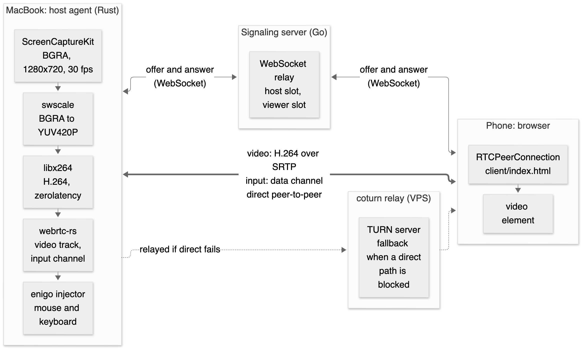
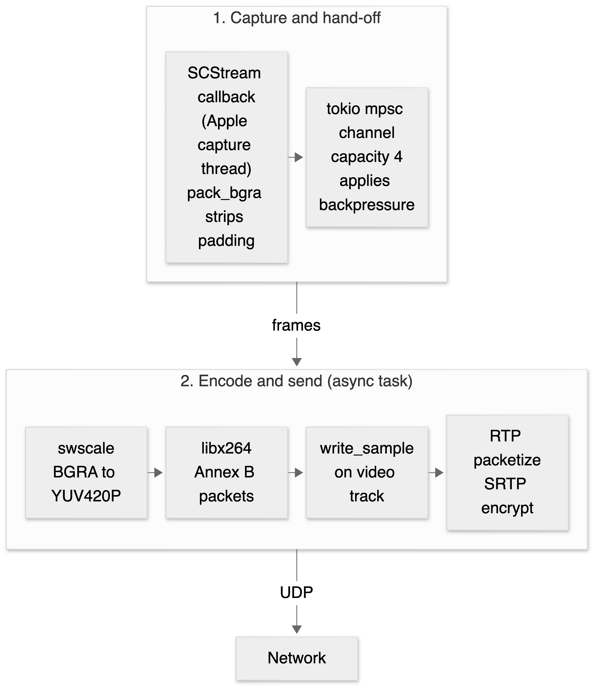
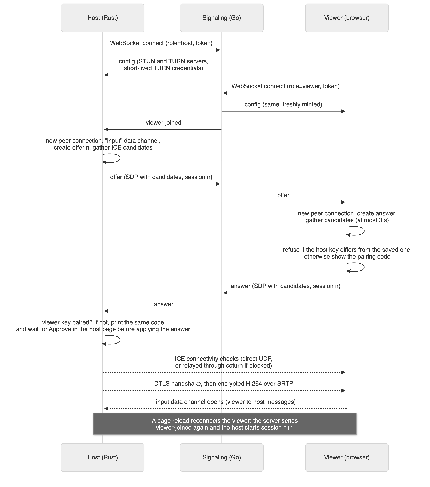
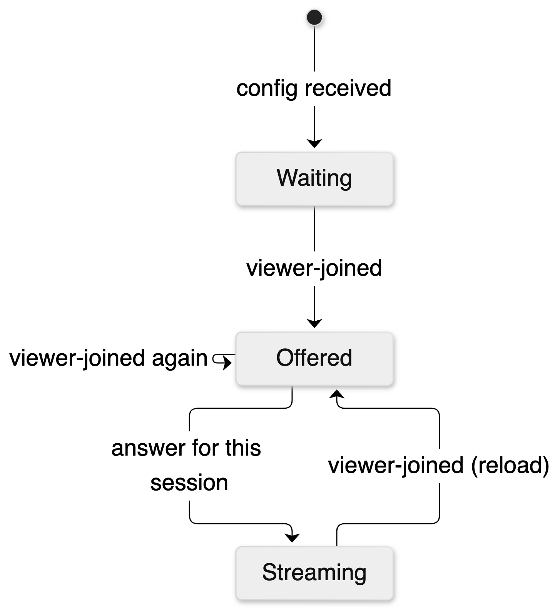

# RemoteBridge

Self-hosted remote desktop. A Rust agent on a MacBook captures the screen,
encodes it to H.264, and streams it over WebRTC to a plain browser page on
a phone. No third-party remote desktop service is involved.

[](https://github.com/AbhishekS-06/RemoteBridge/actions/workflows/ci.yml)


## Current status

| Phase | Scope | State |
|-------|-------|-------|
| v0 | Capture, H.264 encode, write to a local file | Done |
| v1 | Go signaling, WebRTC host, browser client, same LAN | Done |
| v2 | STUN, then self-hosted coturn, so it works across networks | Done: cellular and campus Wi-Fi verified |
| v3 | Input forwarding over data channels, touch mapping | Done (v0.3.0): trackpad-style touch and the on-screen keyboard work from the iPhone through the VPS |
| v4 | Signaling tokens, DTLS fingerprint pairing, multi-device | Planned |
| v5 | Native client, Windows and Linux hosts, clipboard, files, multi-monitor | Planned |

**What works today:** the Mac's screen appears in a browser through a
self-hosted signaling server and coturn relay on a VPS. Verified: a Mac
browser (Chrome or Brave) connecting through the VPS directly, and a
relay-only run that proved the video passes through coturn, and Safari on an
iPhone on cellular streaming from the Mac on home Wi-Fi, in both normal and
relay-only mode. On cellular, ICE picked the TURN relay even in normal mode,
because the carrier's NAT blocked a direct path. Also verified: the Mac on
campus Wi-Fi with the phone on cellular. The host and the viewer can start
in either order, and reloading the viewer (or restarting the host) starts a
new session without restarting anything else. An `input` data channel
from the viewer to the Mac carried test messages in a run with a browser on
the Mac itself. Those test messages have since been replaced by real touch
events (one finger as the left mouse button); clicking and dragging work
from a browser on the Mac itself and from Safari on the iPhone through the
VPS, including a relay-only run with the Mac and the iPhone both on campus
Wi-Fi. Reloading the viewer on the iPhone through the VPS brings the video
back each time. Pointing directly with a finger was awkward on a phone
screen, so touch now works as a trackpad instead (relative cursor, tap to
click, two-finger tap to right click, two-finger slide to scroll),
verified on the iPhone through the VPS. Keyboard input (typed text, named
keys such as enter and the arrows, and Cmd/Ctrl shortcuts) works from the
iPhone's on-screen keyboard, on the same Wi-Fi and through the VPS; the
physical-keyboard path (arrows, shortcuts) is not yet tested.

**Not implemented:** more than one viewer.

## How it works

Three programs cooperate. The host agent produces video, the browser plays
it, and a small signaling server helps the two find each other. Video never
passes through the signaling server.



### Video pipeline (host)

The capture callback runs on a thread owned by Apple's framework, so it
hands frames to the async side through a bounded channel. If the encoder
falls behind, the channel fills and capture waits, so memory stays flat.



### Connection setup (offer and answer)

Before video can flow, both sides must agree on the codec, how to reach each
other (ICE candidates), and encryption fingerprints. The host writes this
into an SDP text block called the offer. The viewer replies with an answer.
The signaling server only carries these two messages.



The server sends `viewer-joined` to the host whenever both sides are
connected, whichever arrived second, so start order does not matter.

### Host sessions (reload)

Each `viewer-joined` starts a new session on the host: it closes the old
peer connection, builds a new one, and sends an offer numbered with the
session. The viewer echoes that number in its answer, and the host ignores
an answer for an older session (possible when the page is reloaded twice
quickly). One video track outlives all sessions, so the capture loop keeps
running and whichever viewer is connected receives it. The signaling server
only relays offers and answers as opaque bytes.



The diagrams are static images rendered from the Mermaid sources in
`docs/diagrams/`. After editing a `.mmd` file, regenerate the PNGs with
`sh docs/diagrams/render.sh` (needs Node and Chrome).

## Tech stack

| Layer | Choice | Why |
|-------|--------|-----|
| Screen capture | `screencapturekit` crate (ScreenCaptureKit) | Apple's supported capture API, delivers BGRA frames |
| Color conversion | FFmpeg `swscale` via `ffmpeg-next` | libx264 needs planar YUV420P, capture gives BGRA |
| Encoding | libx264, `veryfast`, `zerolatency`, no B-frames, keyframe every 1 s, CRF 23 | Lowest latency; B-frames and lookahead add delay |
| Transport | `webrtc-rs` | Peer-to-peer, built-in encryption (DTLS-SRTP), NAT traversal support |
| Async runtime | `tokio` | Required by `webrtc-rs` and the WebSocket client |
| Signaling client (host) | `tokio-tungstenite`, `serde_json` | JSON messages over WebSocket |
| Signaling server | Go, `gorilla/websocket` | Small relay, also serves the client page |
| Client | Plain HTML and JavaScript, browser `RTCPeerConnection` | Nothing to install on the phone |
| NAT traversal (v2) | Public STUN, plus self-hosted coturn (TURN) with short-lived credentials | Direct path when possible, relay when not |
| CI | GitHub Actions: Go fmt, vet, race-enabled tests and govulncheck on Linux; viewer input tests with Node's built-in test runner; host rustfmt check, build, clippy (warnings as errors) and tests on a macOS 26 runner | The host needs ScreenCaptureKit, which only exists on macOS; the capture crate's Swift code needs the macOS 26 SDK |
| Dependency updates | Dependabot: one grouped PR a week each for Rust crates, Go modules and GitHub Actions; webrtc crates excluded | The webrtc crates sit on a vendored, patched webrtc-dtls, so they are upgraded by hand |
| Deploy (planned) | Docker, GitHub Actions, single-node k3s; coturn outside the cluster on host networking | Signaling is stateless HTTP and WebSocket; coturn needs a raw UDP port range |

## Project layout

```
RemoteBridge/
  host/                Rust host agent (macOS)
    src/main.rs          capture handlers, run modes, encode-and-send loop
    src/encoder.rs       H.264 encoder wrapper (YUV420P frames in, Annex B out)
    src/signaling.rs     WebSocket client, Offer and Answer messages
    src/webrtc_host.rs   peer connection, video track, input data channel,
                         offer/answer handshake
    src/input.rs         input messages, frame-to-screen mapping, enigo
                         injector thread (mouse and keyboard)
    .cargo/config.toml   Swift library path and rpath (Command Line Tools only)
  signaling/           Go relay and static file server for client/
    main.go
  client/              Browser viewer
    index.html           page, video, WebRTC setup; wires events to input.mjs
    input.mjs            touch/mouse gestures and keys to input messages (no DOM)
  tests/client/        Node tests for client/input.mjs
  docs/diagrams/       Diagram sources (.mmd) and the rendered PNGs shown above
  docs/deploy.md       Step-by-step VPS deployment of signaling and coturn
  docs/process-log.md  How the project was built: decisions, detours, mistakes
  docs/debugging-log.md  Problems hit, how each was diagnosed, and the fixes
  deploy/              Example configs: coturn, systemd unit, Caddy
  .github/workflows/ci.yml  CI: Go checks, tests and vuln scan; viewer input tests; macOS host build, lints, tests
  .github/dependabot.yml   Weekly grouped dependency update PRs (webrtc crates excluded)
```

## Running it

### Prerequisites

- macOS with Screen Recording and Accessibility permission granted to your
  terminal app. Accessibility is what lets the host move the mouse and
  click; without it the stream still works and the host prints
  `input disabled`.
- Rust toolchain, Go 1.22 or newer
- FFmpeg libraries with libx264 available to `ffmpeg-next`
- Xcode Command Line Tools. `host/.cargo/config.toml` adds the Swift library
  path the capture crate needs when full Xcode is not installed. Keep it.

### Start the stream

1. Start the signaling server. It must run from `signaling/`, because it
   serves `../client`.
   ```
   cd signaling
   go run .
   ```
2. Open the viewer.
   - On the Mac: `http://localhost:8080`
   - On a phone on the same Wi-Fi: `http://<mac-lan-ip>:8080`
     (find it with `ipconfig getifaddr en0`)
3. Start the host from `host/`. Steps 2 and 3 can be swapped.
   ```
   cd host
   cargo run -- webrtc
   ```

At startup the host prints `input ready, display WxH points` (the Mac's
screen size in points). It prints `peer connection state: connected` once
the viewer answers, then `input channel open`. On a touchscreen the video
works like a trackpad:

| Gesture | On the Mac |
|---|---|
| One finger slides | Cursor moves the same distance |
| One-finger tap | Left click (two quick taps: double-click) |
| Tap, then touch again and slide | Drag with the left button held |
| Two-finger tap | Right click |
| Two fingers slide | Scroll, the content following the fingers |

With a mouse (a browser on a computer) the left button clicks and drags at
the pointer's position instead. The viewer's status box counts the events
sent.

Keyboard: on another computer, click the video page and type; keys go to
the Mac. Not from a browser on the host Mac itself: the viewer tab has focus,
so each injected key comes back to the page and is sent again, forever. On the phone, tap the `kbd` button at the bottom right to bring up
the keyboard, and tap it again to hide it. Shortcuts with Cmd or Ctrl
(Cmd+C, Cmd+Tab) are sent as shortcuts, except the ones the browser keeps
for itself (Cmd+W, Cmd+Q, Cmd+T on a computer).
Closing the viewer makes the host log `disconnected` and then `failed`. That
is the normal end of a session. Reloading the viewer prints
`viewer joined, starting session N` and the video comes back within a
couple of seconds.

### Tests

| Part | Command (from the repository root) |
|---|---|
| Signaling server | `cd signaling && go test ./...` |
| Host agent | `cd host && cargo test` |
| Viewer input logic | `node --test tests/client/*.test.mjs` (Node 20+, no packages) |

The viewer tests cover gestures, keys and the phone keyboard field. A real
phone is still needed for the browser and OS parts: the on-screen keyboard,
pointer events and the WebRTC connection.

### Host run modes

| Command | What it does |
|---------|--------------|
| `cargo run` | Captures one frame to `frame.png` |
| `cargo run -- gradient` | Encodes synthetic frames to `out.h264` |
| `cargo run -- capture` | Captures 10 seconds of screen to `capture.h264` |
| `cargo run -- webrtc` | Streams the screen to a connected viewer |

### Configuration

Everything defaults to a local, unauthenticated setup, so the steps above
work with no configuration. To point at a remote server or require a token:

| Setting | Where | Default | Purpose |
|---------|-------|---------|---------|
| `REMOTEBRIDGE_TOKEN` | Signaling server env | unset (open, with a startup warning) | Shared secret every connection must present |
| `REMOTEBRIDGE_ADDR` | Signaling server env | `:8080` | Address the server listens on |
| `--server` or `REMOTEBRIDGE_SERVER` | Host | `ws://localhost:8080` | Signaling server, `ws://` or `wss://` |
| `--token` or `REMOTEBRIDGE_TOKEN` | Host | none | Token to present (prefer the env var; arguments show up in `ps`) |
| `?token=...` on the page URL | Viewer | none | Token the browser presents |
| `REMOTEBRIDGE_TURN_HOST` | Signaling server env | unset (STUN only) | coturn address, `host:port` |
| `REMOTEBRIDGE_TURN_SECRET` | Signaling server env | unset | Secret shared with coturn; set both TURN variables or neither |
| `--relay` or `REMOTEBRIDGE_FORCE_RELAY=1` | Host | off | Use only TURN-relayed candidates, to prove the relay works |
| `?relay=1` on the page URL | Viewer | off | Same, for the browser |

Tokens may only contain letters, digits, `-` and `_`, for example the output
of `openssl rand -hex 16`.

```
# server
export REMOTEBRIDGE_TOKEN=<secret>
go run .

# host
export REMOTEBRIDGE_TOKEN=<secret>
cargo run -- webrtc --server wss://signal.example.com

# viewer (phone)
https://signal.example.com/?token=<secret>
```

## Design decisions

- **Host is the offerer, one offer per viewer.** The server tells the host
  when a viewer joins, and the host answers with a fresh peer connection
  and offer. This replaced an earlier design where the server stored the
  host's single startup offer: that offer could only be used once, so a
  reloaded viewer got nothing until the host restarted.
- **No trickle ICE.** Each side embeds its candidates in the SDP instead of
  sending them one by one, so the protocol has two message types instead of
  three. The host waits for gathering to finish. The viewer waits at most
  3 seconds: on a phone, waiting for gathering to complete could outlast
  ICE's own ~30 s timeout, so the host got the answer too late (debugging
  log #9).
- **The host creates the input data channel.** The host makes the offer,
  so a channel created before it is already in the SDP and the viewer
  receives it with no renegotiation. It is ordered and reliable, because a
  lost or reordered "release" would leave a button held down.
- **Touch is a trackpad, not a pointer.** A finger on a phone-sized
  picture of the Mac's screen hides what it points at and lands a few
  points off, so the page turns gestures into relative moves, clicks,
  button presses and scrolls instead of positions. The gestures are
  recognised on the page, which has the timing and finger count; the host
  only injects. A mouse on a desktop browser still points directly.
- **Positions and distances are sent as fractions of the video frame.**
  The viewer sends `{"type":"down","x":0.5,"y":0.25}` or
  `{"type":"move_rel","dx":0.01,"dy":0}` with values relative to the frame,
  so it never needs the Mac's screen size. Two letterboxes are undone on the way: the
  page measures against the area the video is drawn in (`object-fit:
  contain` adds bars on the phone), and the host removes the black bars
  ScreenCaptureKit adds when it fits a 16:10 screen into the 16:9 frame.
  The mapping has unit tests (`host/src/input.rs`).
- **Typed characters are sent as text, other keys by name.** A
  character goes as `{"type":"text","text":"a"}` and the host enters
  the string as it is, so neither side has to know which keys produce it
  on the Mac's layout. Enter, backspace, the arrows and shortcuts go as
  `{"type":"key","key":"c","mods":["meta"]}`, using the browser's
  key names. The host accepts only a fixed list of names and presses the
  modifiers, the key, and releases the modifiers in one step, so no
  modifier can be left held between messages. The phone's keyboard types
  into a hidden text field that always holds one zero-width space, so
  backspace always has something to delete; the page sends what changed
  and puts the field back after every edit.
- **Injection runs on its own thread.** `enigo` (CGEvent underneath on
  macOS) is driven by one thread that owns it. The data channel callback
  only parses JSON and forwards the event, so it never blocks on the OS.
  When a channel closes the host releases any button it holds, so a
  viewer that disconnects mid-drag cannot leave it held. Relative moves
  and scrolls keep the fraction of a point left over from each event, so
  a slow finger still moves the cursor.
- **No B-frames, no lookahead.** Remote desktop is latency-sensitive, so
  compression efficiency is traded for lower delay.
- **Signaling is not part of the media path.** The server can be replaced or
  moved without touching the video pipeline.
- **A patched copy of `webrtc-dtls` is vendored.** The version `webrtc-rs`
  0.11 depends on picks the first key-exchange curve a browser lists and
  aborts the handshake ("invalid named curve") if it does not support that
  one. Chromium-based browsers list newer curves first, so Chrome and Brave
  could not connect while Safari could. `host/vendor/webrtc-dtls` is that
  exact version with the fix upstream later made (choose the first curve
  both sides support), wired in through `[patch.crates-io]` in
  `host/Cargo.toml`. It should be removed when `webrtc` is upgraded.
- **TURN credentials are minted per connection, not stored in the page.** A
  browser cannot keep a permanent TURN password secret. The signaling server
  signs a username containing an expiry time with a secret it shares with
  coturn (HMAC-SHA1, coturn's `use-auth-secret` scheme) and sends the result
  in a `config` message right after connecting. Leaked credentials stop
  working after 24 hours, and the shared secret never leaves the servers.

## Security

- Media is encrypted end to end by WebRTC (DTLS-SRTP). The TURN relay only
  forwards encrypted packets and cannot see the screen.
- The signaling server accepts a shared token (`REMOTEBRIDGE_TOKEN`) and
  rejects connections without it before they can take a slot. Without a
  token set it is open, and it logs a warning at startup. Do not expose an
  open server publicly while the host is running.
- Over plain `ws://` the token travels in clear text. For a public server,
  put TLS in front of it and use `wss://`; the host supports `wss://`.
- The viewer's token is in the page URL, so it can end up in browser history
  and server logs. This is a stopgap. DTLS fingerprint pairing and
  per-device tokens are planned for v4. No custom cryptography is used.

## Known limitations

- Networks that block both UDP and TCP on port 3478 would need coturn on
  port 443, which conflicts with Caddy and is not set up. The campus network
  tested allows 3478.
- No trickle ICE: the viewer sends its answer once gathering completes or
  after 3 seconds, whichever comes first.
- The shared token is in the page URL, and the test server is a single Vultr
  instance meant to be destroyed after testing (see `docs/deploy.md`).
- If the signaling server restarts, both sides must be restarted: neither
  reconnects its WebSocket.
- The host captures and encodes even when no viewer is connected.
- The trackpad gestures have no pinch zoom, so small text on a phone is
  still hard to read.
- Keyboard: no function keys, no composed input (IME, such as Japanese),
  and Option dead keys (Option+E for an accent) do nothing. Browser-owned
  shortcuts such as Cmd+W act on the viewer's browser, not the Mac.
- The viewer page shows "connecting to signaling..." until the first offer
  arrives, even when its WebSocket is connected and only the host is
  missing.
- One viewer at a time, main display only, macOS host only.
- No audio and no automatic reconnect.
